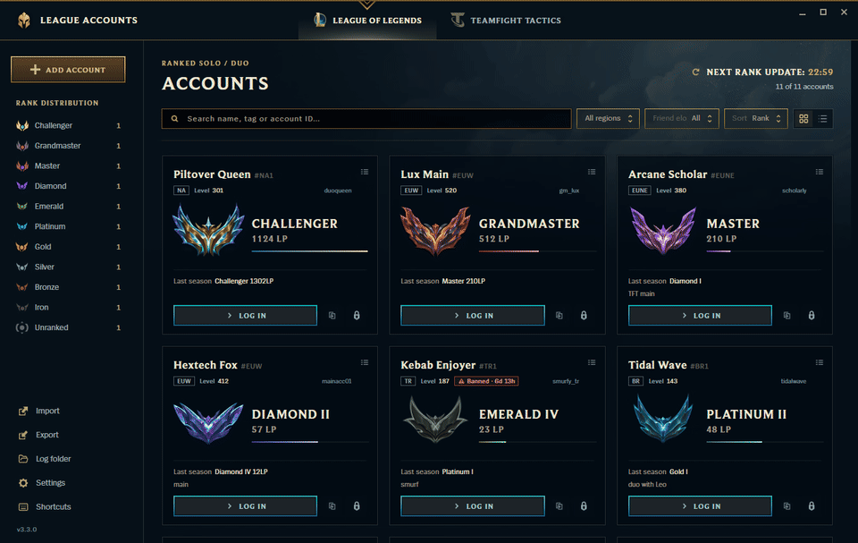
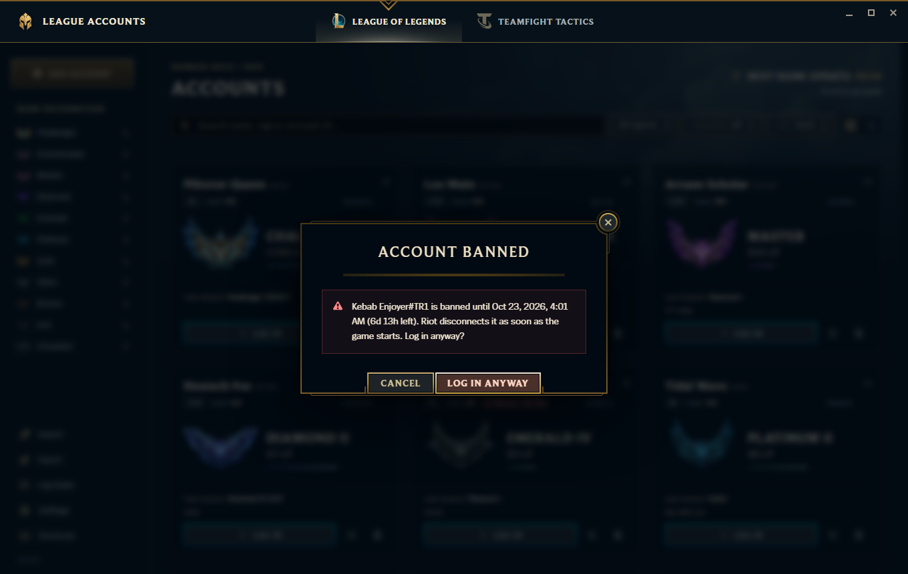
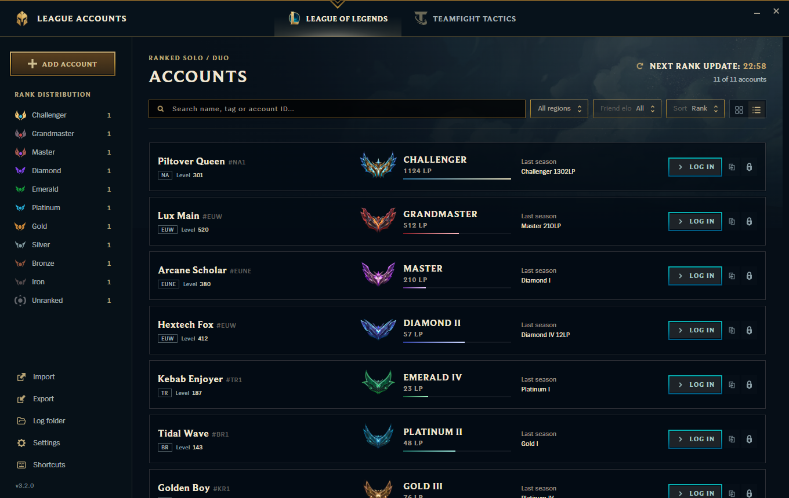
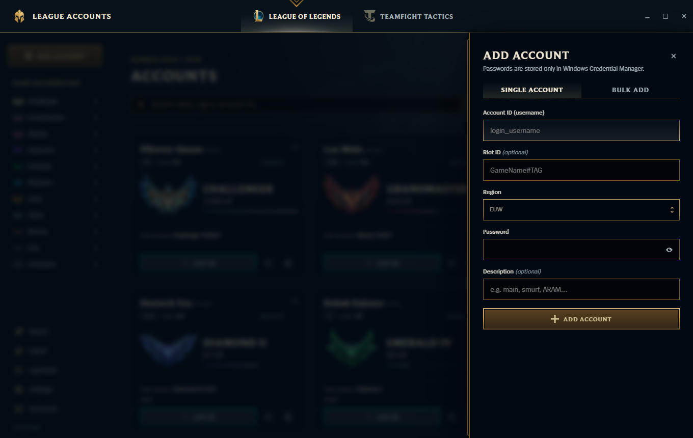
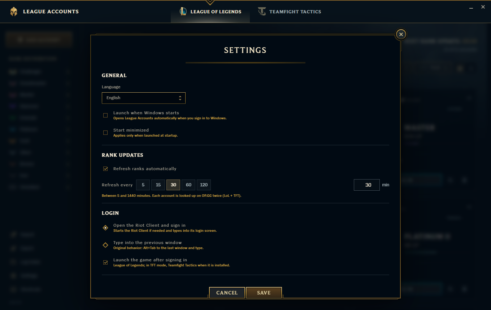
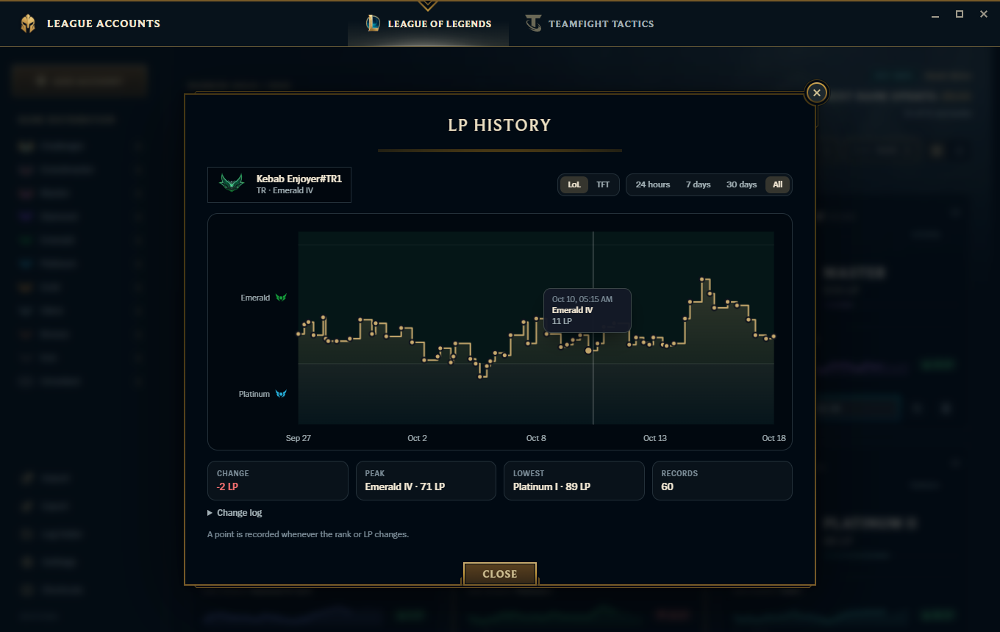

<div align="center">


# League Accounts

**All your League of Legends & Teamfight Tactics accounts in one place.**
One-click login, live ranks and ban countdowns, with passwords kept in Windows Credential Manager.

[](https://github.com/FurkanZhlp/LeagueAccounts/releases/latest)

[](LICENSE)



</div>

## Features

- **One-click login.** League Accounts opens the Riot Client, signs in and launches LoL or TFT.
- **LoL and TFT ranks** from OP.GG, refreshed in the background (every 30 minutes by default).
- **LP history** *(this fork)*. Every refresh is recorded: cards show a trend line and the LP change over the last 24 hours, and each account has a full history chart (right-click → **LP history**).
- **Change passwords** *(this fork)*. Edit an account and fill in *New password* to update the stored one.
- **Duo finder.** The *Friend elo* filter shows which accounts can play ranked with a friend.
- **Ban check.** Each login reads the account's League ban from Riot; a banned account shows the time left instead of launching a game that would disconnect you.
- **Safe by design.** Passwords stay in Windows Credential Manager and never reach the interface.
- **Made for daily use.** Launch with Windows, keyboard shortcuts, import/export, automatic updates, 6 languages.

## Installation

1. Download **`LeagueAccounts.exe`** from the [latest release](https://github.com/FurkanZhlp/LeagueAccounts/releases/latest).
2. Put it in a folder of your own (e.g. `Documents\LeagueAccounts`, not `Program Files`, so it can update itself) and run it.
3. If SmartScreen says *"Windows protected your PC"* (the app is not code-signed), click **More info → Run anyway**.

Requires Windows 10 or 11 with [WebView2](https://developer.microsoft.com/microsoft-edge/webview2/) (preinstalled on current Windows). The app updates itself from this repository's releases; turn it off in **Settings → Updates**.

## Usage

**Add accounts** with **Add account** (`Ctrl+N`): the Riot Client username, password, region and, optionally, the Riot ID (`Name#TAG`) used to look up ranks. To add many, paste one per line in **Bulk add**:

```text
username1--Player One#EUW--password1
username2----password2
```

**Log in** with the card's **Log in** button. If another account is signed in, it is signed out first, and you're warned before an open League client is closed (or a match left). For 2FA or a captcha, finish in the Riot window; the game launches once the sign-in is confirmed. If Riot reports a ban, the game isn't started: the card shows the time left, and logging in again before it ends asks whether to launch the game anyway. With game launch off, a banned account still signs in to the Riot Client.

<table>
  <tr>
    <td width="50%"><br /><sub><b>Ban check:</b> see how long a ban lasts before you log in.</sub></td>
    <td width="50%"><br /><sub><b>List view</b> for many accounts.</sub></td>
  </tr>
  <tr>
    <td><br /><sub><b>Add one account or paste many.</b></sub></td>
    <td><br /><sub><b>Settings:</b> language, startup, refresh interval, login method, updates.</sub></td>
  </tr>
  <tr>
    <td colspan="2"><br /><sub><b>LP history</b> <i>(this fork)</i>: tier bands, hover readout, 24h / 7d / 30d / all.</sub></td>
  </tr>
</table>

<details>
<summary><b>Keyboard shortcuts</b></summary>

| Shortcut | Action |
|---|---|
| `Ctrl+Shift+V` | Log in with the selected account |
| `Ctrl+C` | Copy the account ID (press again for the password) |
| `↑ ↓ ← →` | Move between accounts |
| `Delete` | Delete the selected account (asks first) |
| `Ctrl+F` / `Ctrl+N` / `Ctrl+,` | Search / Add account / Settings |
| `Ctrl+R` / `F5` | Refresh ranks |
| `Ctrl+1` / `Ctrl+2` | League of Legends / TFT mode |
| Double-click / Right-click | Edit / All actions |

</details>

## Privacy and security

- Passwords are stored in **Windows Credential Manager** (service `LeagueAccounts`), never in the app's files. Copied passwords are cleared from the clipboard after 30 seconds and kept out of clipboard history.
- **Exports contain passwords in plain text.** Keep them private.
- The app only contacts OP.GG (ranks), the Riot Client on `127.0.0.1` and GitHub (updates). No telemetry, no account server.
- Accounts, settings and logs (fixed event codes, no account data) live in `%APPDATA%\LeagueAccounts\`.

## Troubleshooting

| Problem | What to do |
|---|---|
| *Riot Client was not found* | Install the Riot Client, or use **Settings → Login → Type into the previous window**. |
| *The Riot Client login screen or sign-in status wasn't ready in time* | Open the Riot Client once manually (it may be updating), then retry. |
| Ranks show **Unavailable** or *Riot ID not found* | Check the Riot ID and region; OP.GG may also be rate-limiting. |
| Anything else | Attach the newest file from **Log folder** (sidebar) to an [issue](https://github.com/FurkanZhlp/LeagueAccounts/issues). |

Want to build or contribute? See [CONTRIBUTING.md](CONTRIBUTING.md).

## Credits and license

This is a fork of [LeagueAccounts](https://github.com/Tariolle/LeagueAccounts) by Florent Tariolle that keeps the LP history tracking and password editing the upstream project leaves out, and stays in sync with upstream otherwise. Thanks to [@GothHeit](https://github.com/GothHeit) for several fixes.

Code under the [MIT License](LICENSE). Bundled Riot Games artwork, fonts and animations keep their original rights; see [THIRD_PARTY_ASSETS.md](THIRD_PARTY_ASSETS.md).

League Accounts isn't endorsed by Riot Games and doesn't reflect the views or opinions of Riot Games or anyone officially involved in producing or managing Riot Games properties. Riot Games, League of Legends and Teamfight Tactics are trademarks or registered trademarks of Riot Games, Inc. Rank data comes from OP.GG; this project is not affiliated with OP.GG. Sharing accounts may be against Riot Games' Terms of Service; you are responsible for how you use this tool.
